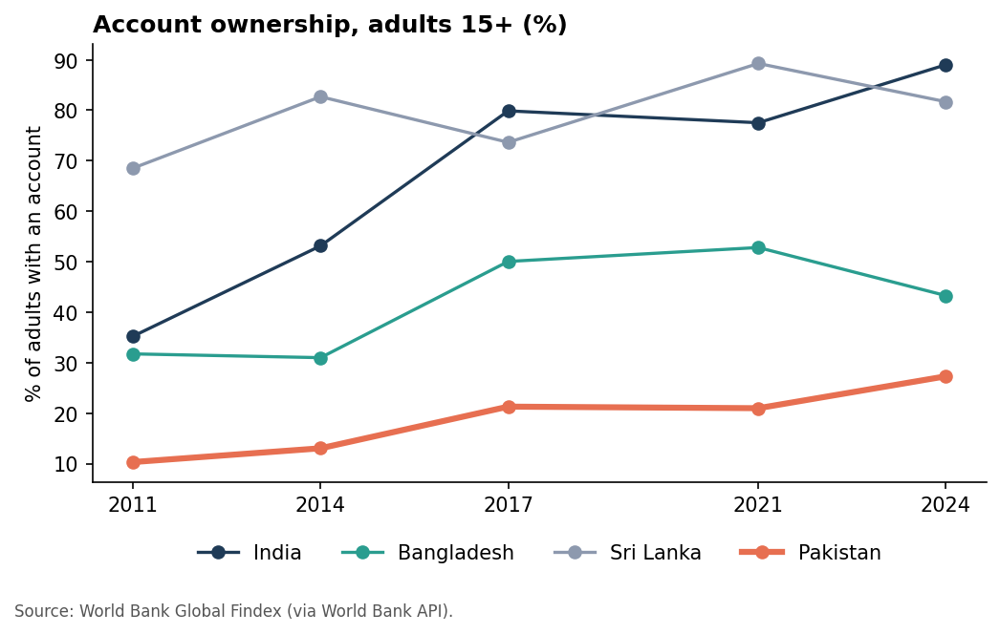
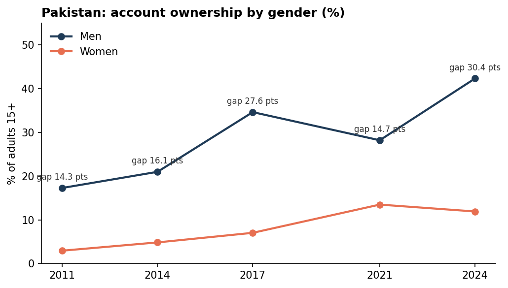
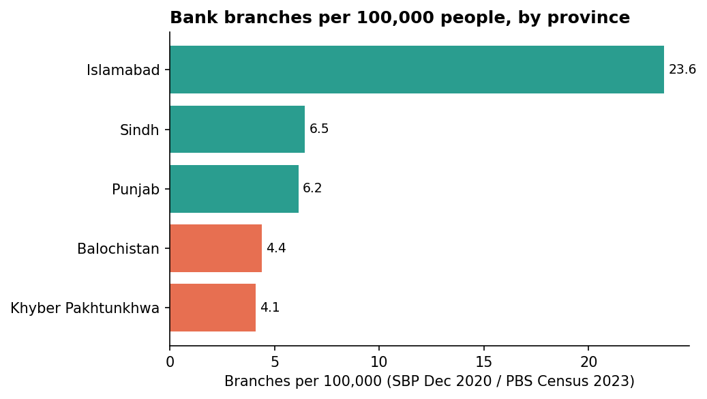
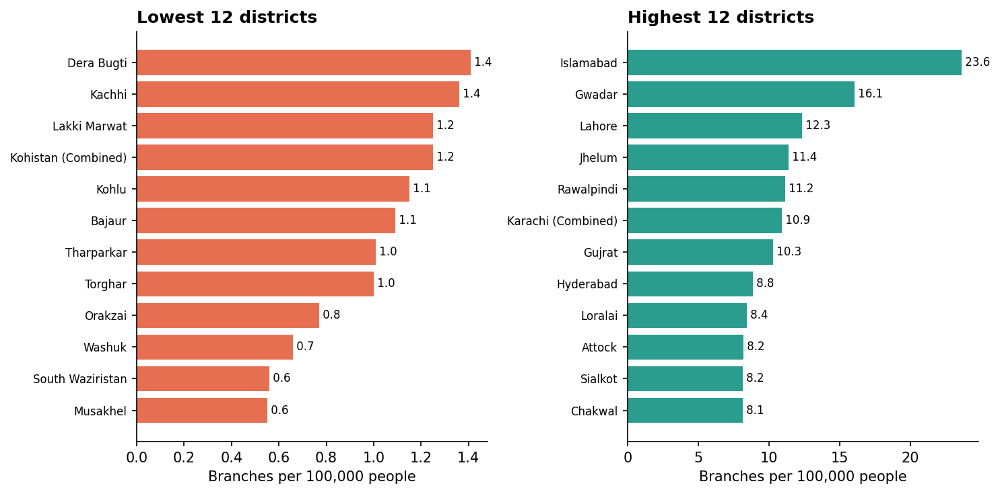

# Financial Inclusion Gap in Pakistan

**Business question:** Where in Pakistan are people excluded from formal finance, and how much do gender and geography shape that gap?

Pakistan has the lowest account ownership of the four countries compared, and the gender gap is widening. Bank branch density is lowest in Balochistan and Khyber Pakhtunkhwa, where 39 of 119 districts (17% of the population) fall below half the national average. The full recommendation is in [docs/recommendation_memo.md](docs/recommendation_memo.md).

## Key results

| Measure | Result |
|---|---|
| Account ownership, adults 15+ (2024) | Pakistan 27.3% · India 89.0% · Sri Lanka 81.7% · Bangladesh 43.3% |
| Gender gap in Pakistan (2024) | Men 42.3% vs women 11.9%, a 30.4-point gap |
| Branches per 100,000 people (matched districts) | National 5.95 · Islamabad 23.6 · Sindh 6.5 · Punjab 6.2 · Balochistan 4.4 · KP 4.1 |
| Districts below half the national branch density | 39 of 119, holding 17.0% of the population |

## Dashboard

- Interactive web dashboard: [dashboard/dashboard.html](dashboard/dashboard.html). Open it in a browser (it loads Plotly from a CDN, so it needs an internet connection). Live at https://maira-w.github.io/pakistan-financial-inclusion/dashboard/dashboard.html once GitHub Pages has built.
- Power BI report: `powerbi/Pakistan_Financial_Inclusion.pbix`. Build it with [powerbi/BUILD_GUIDE.md](powerbi/BUILD_GUIDE.md), using the tables in `powerbi/data/` and the measures in `powerbi/measures.dax`.
- Static charts: [dashboard/](dashboard/)






## Repository layout

```
data/raw/        Source files, untouched (World Bank API JSON, PBS census CSVs, SBP appendix PDF)
data/clean/      Analysis tables produced by scripts/build_clean_data.py
scripts/         build_clean_data.py (extract and clean), analysis.py (charts and web dashboard),
                 build_powerbi_model.py (tables for Power BI)
dashboard/       Charts (PNG) and the interactive web dashboard (HTML)
powerbi/         Power BI report: BUILD_GUIDE.md, measures.dax, theme.json, data/ (tables to import)
docs/            data_sources.md (sources and data issues), recommendation_memo.md
```

## Method

1. **Peer benchmark.** Global Findex account ownership for Pakistan, India, Bangladesh and Sri Lanka, 2011-2024, pulled from the World Bank API.
2. **Branch density.** SBP district-wise scheduled bank branches (31 Dec 2020) divided by PBS Census 2023 district population. Districts were matched by name, with a manual mapping for renamed districts. Where several 2023 districts make up one 2020 district (Karachi, Chitral, Kohistan), they are combined into one unit.
3. **Checks.** Every SBP row is checked so that conventional + Islamic = total. Islamabad and Lahore populations match the official PBS site. Branch totals reconcile to the SBP grand total of 14,849.

## Data issues (summary)

Full details are in [docs/data_sources.md](docs/data_sources.md).

- The SBP province table does not match the SBP district table (Islamabad: 303 vs 558). The district table is used because it reconciles to the grand total.
- Branch data is from December 2020, population from 2023.
- AJK and Gilgit-Baltistan are excluded (not in the PBS district table; 638 branches).
- Nine districts created after 2020 are left blank, not shown as zero.

## Limitations

- Branch counts show where formal banks are, not where people use financial services. Mobile wallets and agents are not counted.
- Survey-based access measures (Global Findex) and registered-account counts (SBP) use different definitions and are not directly comparable.
- Low branch density does not automatically mean unmet demand. Combine with household income data before making investment decisions.

## How to run

```bash
pip install -r requirements.txt
python scripts/build_clean_data.py
python scripts/analysis.py
python scripts/build_powerbi_model.py
```

The first script reads the raw files in `data/raw/` and writes `data/clean/`. The second writes the charts and `dashboard/dashboard.html`. The third writes the tables that Power BI imports into `powerbi/data/`.

## Sources

- World Bank Global Findex: https://www.worldbank.org/en/publication/globalfindex
- PBS Population Census 2023: https://census23.pbos.gov.pk/Analysis/DistrictWise (district tables from a third-party conversion: https://github.com/fahad-mirza/pakistan_census_2023_tables)
- SBP Statistics on Scheduled Banks, Appendix 3(b), 31 Dec 2020: https://www.sbp.org.pk/assets/document/IV__Appendices11_statistics_december_2020.pdf
