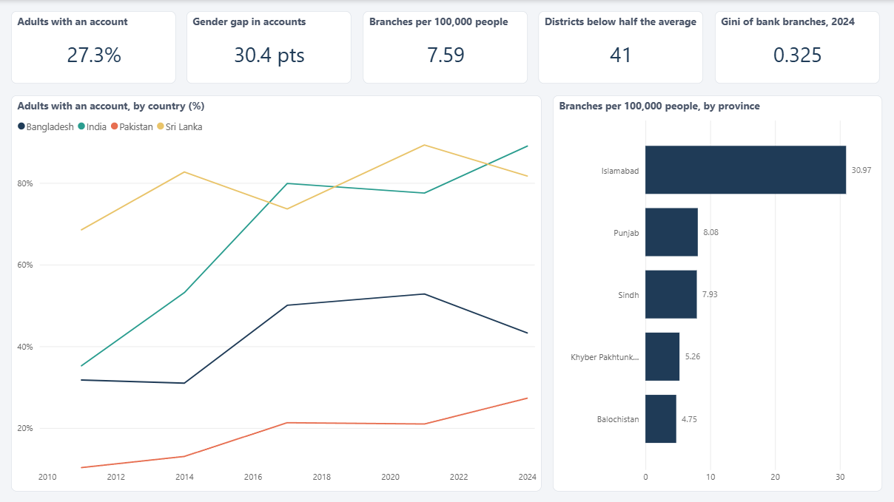
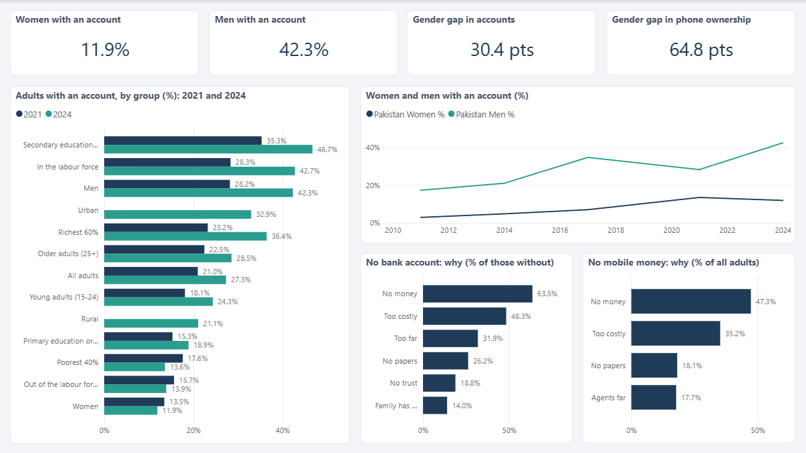
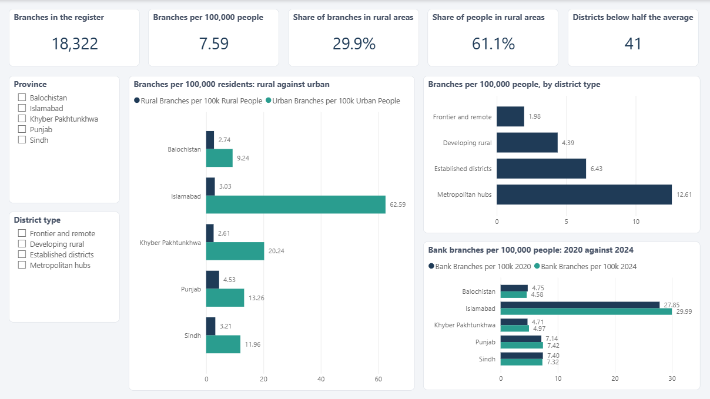
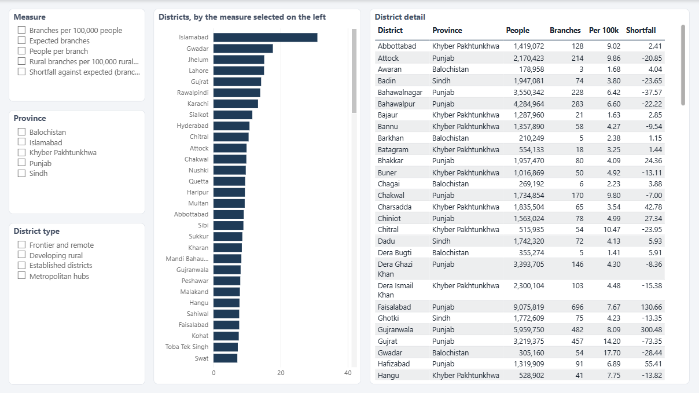
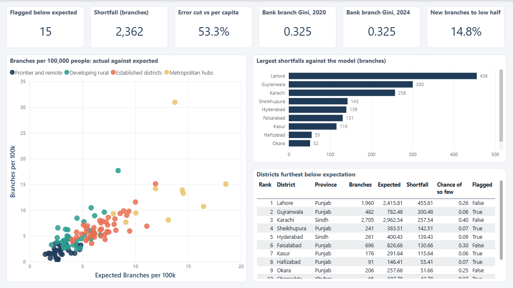
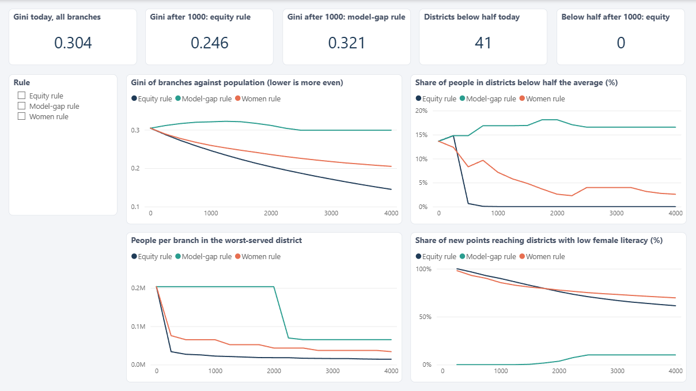
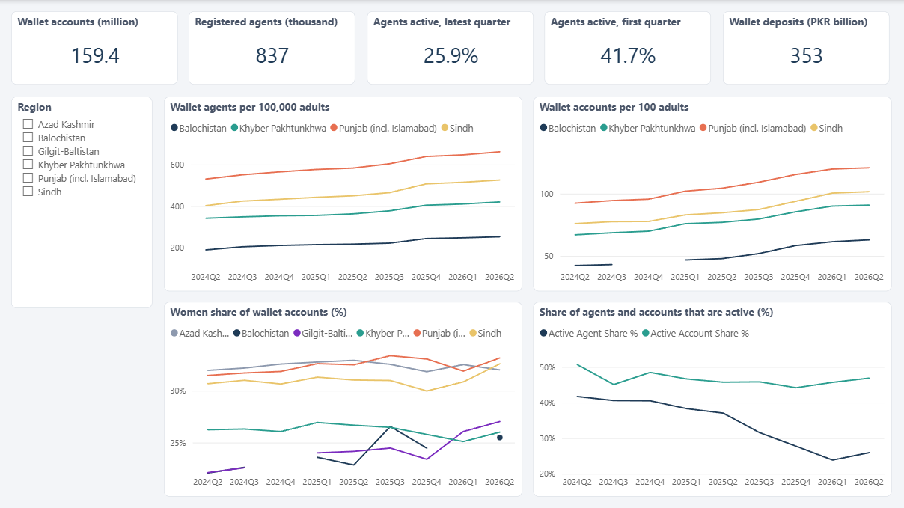
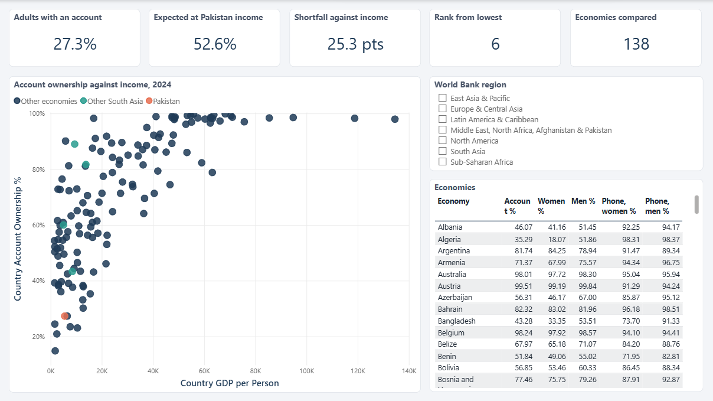
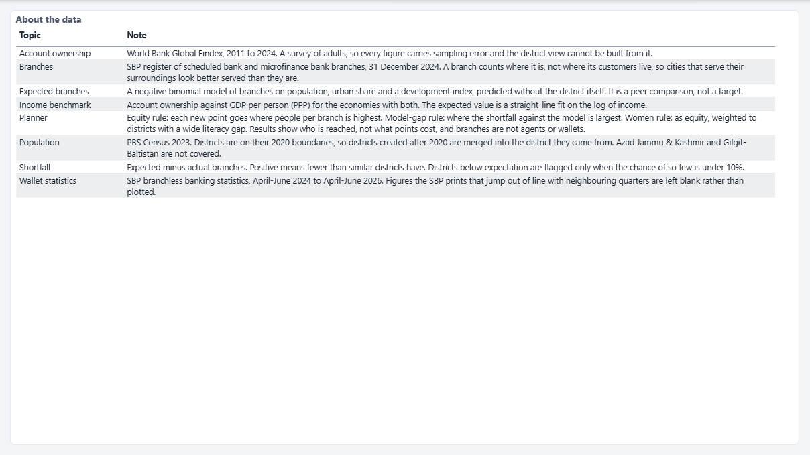

# Power BI report

A 9-page report built on a star-schema model with 73 DAX measures. It uses the same numbers as the web dashboard and the documents, because all three are generated from the same results.

## Opening it

| File | Use it for |
|---|---|
| [`Pakistan_Financial_Inclusion.pbix`](../powerbi/Pakistan_Financial_Inclusion.pbix) | **Just looking.** The data is inside; double-click and it opens. Needs Power BI Desktop (free from Microsoft). |
| [`Pakistan_Financial_Inclusion.pbip`](../powerbi/Pakistan_Financial_Inclusion.pbip) | **Working on it, or reading it in Git.** A Power BI project: the model is plain text (TMDL) and each page and visual is a small JSON file. A project stores no data, so Power BI Desktop shows a **Refresh now** banner the first time; click it once and wait. |
| [`measures.dax`](../powerbi/measures.dax) | Every measure as text, grouped by folder, with a description. |

`python -m fininc report` regenerates the project and `measures.dax`. The `.pbix` is a snapshot saved from the opened project (File, Save as) and is not rewritten by that command.

## Pages

| # | Page | What it shows | Visuals | Made of |
| ---: | --- | --- | ---: | --- |
| 1 | **Overview** | The headline: account ownership against peer countries, branch density by province, and how unevenly branches are spread. | 7 | 5 cards, 1 line chart, 1 bar chart |
| 2 | **Who is left out** | Who is left out: account ownership by gender, age, income, education and place, women and men over time, and why people have no account. | 8 | 4 cards, 3 bar charts, 1 line chart |
| 3 | **Where branches are** | Where branches are: rural against urban, by district type, and bank branches in 2020 against 2024. Slicers for province and district type. | 10 | 5 cards, 3 bar charts, 2 slicers |
| 4 | **District explorer** | Pick a measure and compare all 120 districts; filter by province and district type; a table of district detail. | 5 | 3 slicers, 1 bar chart, 1 table |
| 5 | **Gaps and drivers** | What the model expects: actual against expected branches, the districts furthest below expectation, and the lack of catch-up. | 9 | 6 cards, 1 scatter chart, 1 bar chart, 1 table |
| 6 | **Planner** | Where new points go: four outcomes under three placement rules for programme sizes up to 4,000 points. | 10 | 5 cards, 4 line charts, 1 slicer |
| 7 | **Digital layer** | The digital layer: wallet accounts, agents per 100,000 adults, the women's share and how many agents are active. | 10 | 5 cards, 4 line charts, 1 slicer |
| 8 | **Income benchmark** | Pakistan against other economies: account ownership against income, with Pakistan and South Asia highlighted. | 8 | 5 cards, 1 scatter chart, 1 slicer, 1 table |
| 9 | **About the data** | Sources, definitions and caveats. | 1 | 1 table |

Slicers cross-filter the other visuals on a page; the two district slicers work through the relationships below.

## Preview

Every page, saved from Power BI Desktop. Click an image for the full size.

<table>
<tr>
<td width="50%"><a href="powerbi_pages/01_overview.png"></a><br><sub>Page 1: Overview</sub></td>
<td width="50%"><a href="powerbi_pages/02_who.png"></a><br><sub>Page 2: Who is left out</sub></td>
</tr>
<tr>
<td width="50%"><a href="powerbi_pages/03_where.png"></a><br><sub>Page 3: Where branches are</sub></td>
<td width="50%"><a href="powerbi_pages/04_explorer.png"></a><br><sub>Page 4: District explorer</sub></td>
</tr>
<tr>
<td width="50%"><a href="powerbi_pages/05_gaps.png"></a><br><sub>Page 5: Gaps and drivers</sub></td>
<td width="50%"><a href="powerbi_pages/06_planner.png"></a><br><sub>Page 6: Planner</sub></td>
</tr>
<tr>
<td width="50%"><a href="powerbi_pages/07_digital.png"></a><br><sub>Page 7: Digital layer</sub></td>
<td width="50%"><a href="powerbi_pages/08_income.png"></a><br><sub>Page 8: Income benchmark</sub></td>
</tr>
<tr>
<td width="50%"><a href="powerbi_pages/09_about.png"></a><br><sub>Page 9: About the data</sub></td>
</tr>
</table>

## Data model

| Table | Rows | Columns | Role |
| --- | ---: | ---: | --- |
| `districts` | 120 | 31 | One row per analysis unit: population, branches 2020 and 2024, expected branches, shortfall and flags. The fact table. |
| `provinces` | 5 | 2 | The five provinces and territories. Filters districts. |
| `district_types` | 4 | 10 | The four district types, with averages. Filters districts and sorts them by development. |
| `top_gaps` | 10 | 12 | The 10 districts furthest below the model's expectation. |
| `findex` | 598 | 7 | Global Findex indicators for Pakistan, India, Bangladesh and Sri Lanka, 2011 to 2024. |
| `segments` | 24 | 4 | Account ownership in Pakistan by group, 2021 and 2024. |
| `barriers` | 10 | 6 | Reasons for having no bank account or no mobile money account. |
| `scenario` | 51 | 10 | Planner outcomes by number of points added and placement rule. |
| `wallet` | 54 | 10 | Mobile wallet accounts and agents by region and quarter (irregular figures left blank). |
| `wallet_national` | 9 | 10 | Wallet totals by quarter: accounts, agents, deposits and the active shares. |
| `countries` | 138 | 22 | Account ownership, phones and income for every economy in the benchmark. |
| `headline` | 1 | 14 | One row of single numbers (Gini, shortfall, catch-up) read by cards. |
| `metric_choice` | 5 | 1 | The measures a slicer can pick on the District explorer page (a disconnected table). |
| `notes` | 8 | 2 | The text on the About page. |

```
provinces ──┐
            ├──< districts >──┐
(1 to many) │   (fact table)  │ (1 to many)
district_types ───────────────┘
```

`districts` is the only table with relationships; the others are read by measures that filter them directly (for example `findex[country] = "PAK"`). Each table is stored in the model itself as compressed text, which is how Power BI keeps "Enter data" tables, so the project needs no other file. Columns that hold a district type sort by development rather than alphabetically (`sortByColumn`).

## Measures

| Folder | Measures | Examples |
| --- | ---: | --- |
| Helpers | 1 | `Selected Year` |
| Account ownership | 11 | `Account Ownership %`, `Pakistan Account Ownership %`, `Pakistan Women %`, `Pakistan Men %`, ... |
| Branches | 20 | `Total Branches`, `Bank Branches`, `Microfinance Branches`, `Rural Branches`, ... |
| Access gap model | 14 | `Expected Branches`, `Expected Branches per 100k`, `Total Shortfall`, `Top Gap Shortfall`, ... |
| Planner | 10 | `Scenario Gini`, `Scenario Population Below Half %`, `Scenario Districts Below Half`, `Scenario Worst People per Branch`, ... |
| Digital layer | 10 | `Wallet Agents per 100k Adults`, `Wallet Accounts per 100 Adults`, `Wallet Women Share %`, `Active Agent Share %`, ... |
| Income benchmark | 7 | `Country GDP per Person`, `Country Account Ownership %`, `Expected Account Ownership %`, `Pakistan Expected Account Ownership %`, ... |

A few patterns worth knowing:

- **Measures live in a table called `_Measures`.** Power BI rejects a table named `Measures`.
- **A year-filtered measure keeps the year in a variable.** Filtering a column by a measure inside `CALCULATE` makes the measure invalid, so the measure first reads the year and then filters by it:

  ```dax
  Pakistan Women % =
  VAR y = [Selected Year]
  RETURN
      CALCULATE ( AVERAGE ( findex[value] ),
                  findex[country] = "PAK", findex[indicator] = "account.t.d.1", findex[year] = y )
  ```

  The same measure works for a card (latest year) and for a line chart (one year per point), because `Selected Year` returns the year on the axis, or the latest when there is none.
- **A disconnected table drives a switch.** The Measure slicer on the District explorer page reads `metric_choice[metric]`, and one measure returns the matching calculation:

  ```dax
  Selected District Metric =
  SWITCH ( SELECTEDVALUE ( metric_choice[metric], "Branches per 100,000 people" ),
           "Branches per 100,000 people", [Branches per 100k],
           "People per branch", [People per Branch],
           ... , BLANK () )
  ```
- **Low density is computed, not stored.** `Districts Below Half National Avg` compares each district with half the national average inside `FILTER`, so it answers to the province and district-type slicers while the national average stays fixed.
- **A rank without `RANKX`.** `Pakistan Rank From Lowest` counts the economies at or below Pakistan's account ownership over `ALL ( countries )`.

## How it was built and checked

- The model, report and theme are written by [`fininc/powerbi`](../fininc/powerbi) from `data/processed`; none of it is edited by hand. The project is written in the format Power BI Desktop itself saves, and its JSON files were checked against Microsoft's published schemas when they were built (Desktop writes a newer visual schema version than the latest one published, so the previous one was used for those files).
- Power BI Desktop was run on the project. All 73 measures were evaluated through its local model and had no errors, and their values were compared with the Python results (for example 18,322 branches, 27.3% account ownership, 41 districts below half the national average, and a Gini of 0.304 before and 0.246 after 1,000 points under the equity rule).
- Every page was opened in Power BI Desktop and inspected, which found and fixed truncated card titles, raw column names and cut-off columns in tables, a scatter chart crowded against the axes and over-long legend labels.

## Limits

- Built and tested with a current Power BI Desktop (the project format needs a recent version). Older versions may not open the `.pbip`; the `.pbix` is saved by the version used here.
- The `.pbix` and the screenshots in [`powerbi_pages`](powerbi_pages) are saved by hand from Power BI Desktop and are not rewritten by `python -m fininc report`. If the data or the generator change, open the project, refresh, check the pages and save them again; a test fails when the `.pbix` no longer matches the report.
- The Global Findex figures are survey estimates; district figures are about branches, not account ownership.
